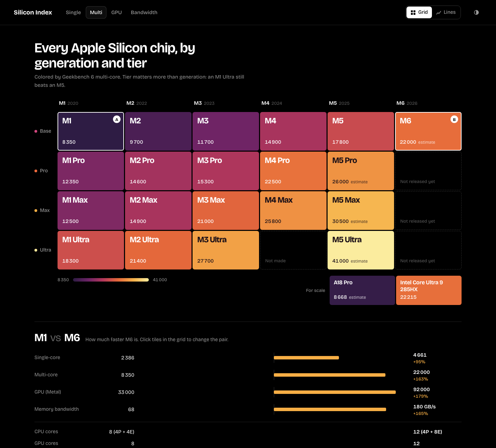
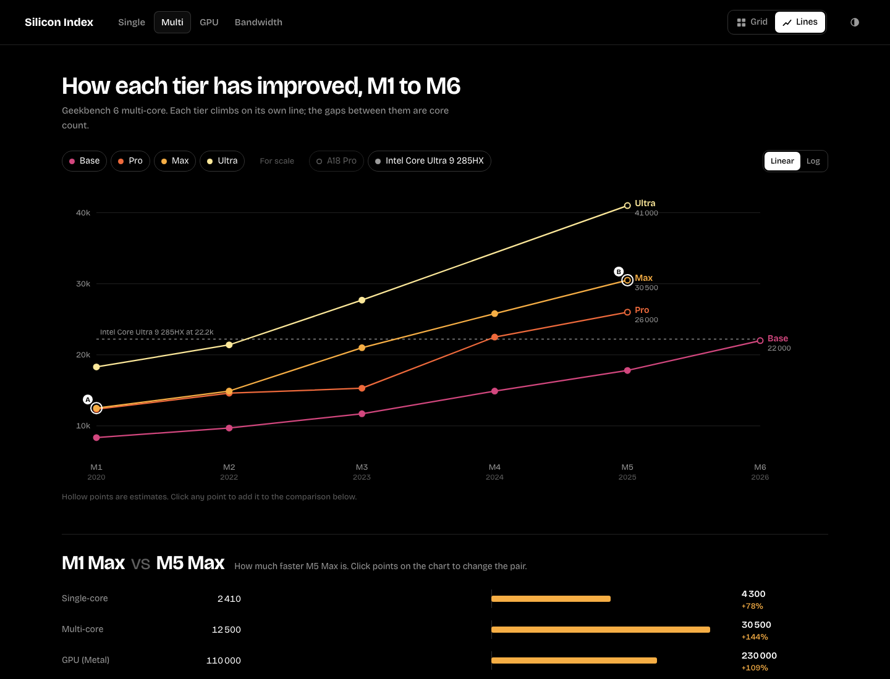

# Silicon Index

The best way to read Apple Silicon benchmarks.

## Why this exists

Search for how fast any M-series chip is and you get the same few things: a Geekbench Browser list, a matplotlib chart in an article, a spec table. The data is all public. Nobody has presented it well.

Silicon Index takes benchmark results that already exist (Geekbench, Cinebench, Blender, reviewer tests), cleans them up, cites them, and presents them in a way that is quick to read and pleasant to explore. We don't run benchmarks ourselves. Every number links back to where it came from.

## Who it's for

In priority order:

1. **People who want the data.** Single-core, multi-core, GPU, memory bandwidth, change from one generation to the next, chip against chip. This comes first, and the UX for it has to be excellent.
2. **People who want an answer.** "This is my workload. What should I buy?" This is built on top of the same data once the first part is solid.

## Principles

- **Design first.** The reason this project exists is that existing sites look bad and get in the way. Clarity, contrast and speed matter more than feature count.
- **Honest data.** Every number carries its benchmark, version, source, date and sample count. Benchmark versions with different scales (Geekbench 6 and Geekbench 7) are never mixed on one axis. Estimates are marked as estimates.
- **Chips and machines are different things.** The same chip comes in different core counts (M4 has 8, 9 and 10-core versions) and performs differently in a fanless MacBook Air than in a Mac Studio. The data model keeps chip family, configuration and device separate.
- **Not Apple-only forever.** M-series first, but nothing in the data model is Apple-specific. Snapdragon, Intel and AMD chips can be added later as data, without a rewrite.

## Where it stands

Design exploration, no production app yet.

- `design/d-hybrid.html` is the current direction: pure black, full contrast, with a **Grid** view (generation × tier heat map, the default) and a **Lines** view (one line per tier from M1 to M6). The chosen metric, two picked chips and the head-to-head comparison are shared across both views.
- `design/a-trajectory.html`, `b-index.html` and `c-grid.html` are the earlier directions it came from. B was dropped.
- `design/PLANS.md` has the reasoning behind each direction.
- `design/data.js` is **sample data** for the prototypes. Some numbers are estimates; none are final.

Open any file in `design/` directly in a browser. There is no build step.

## Planned stack

- Next.js, TypeScript and Tailwind, built as a static site and hosted on Vercel
- Hand-built SVG charts, with d3 for scales and maths
- Benchmark data as typed files in the repo, checked against a schema in CI, so a data update is a reviewable pull request

## Open questions

- More views beside Grid and Lines, such as price against performance?
- Head-to-head with two chips, or up to four?
- Which sources to start with, and how to keep them current
- How the "what should I buy" flow should work

## Design skill

`.claude/skills/frontend-design` is Anthropic's frontend-design skill, vendored from [anthropics/skills](https://github.com/anthropics/skills/tree/main/skills/frontend-design) under the Apache 2.0 license (see its `LICENSE.txt`). All design work in this repo goes through it.
